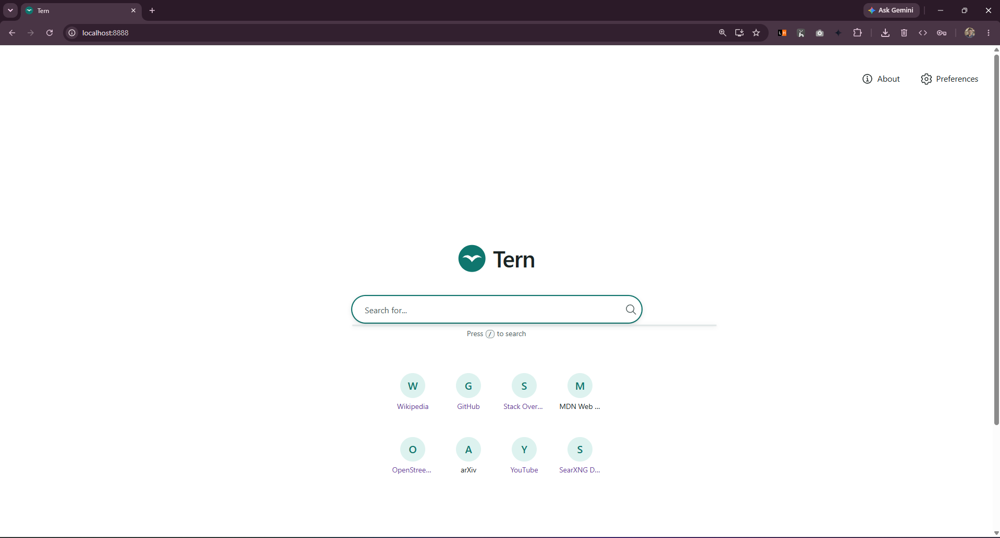
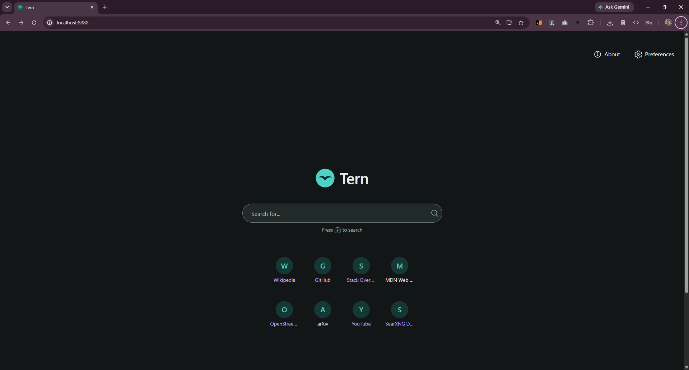
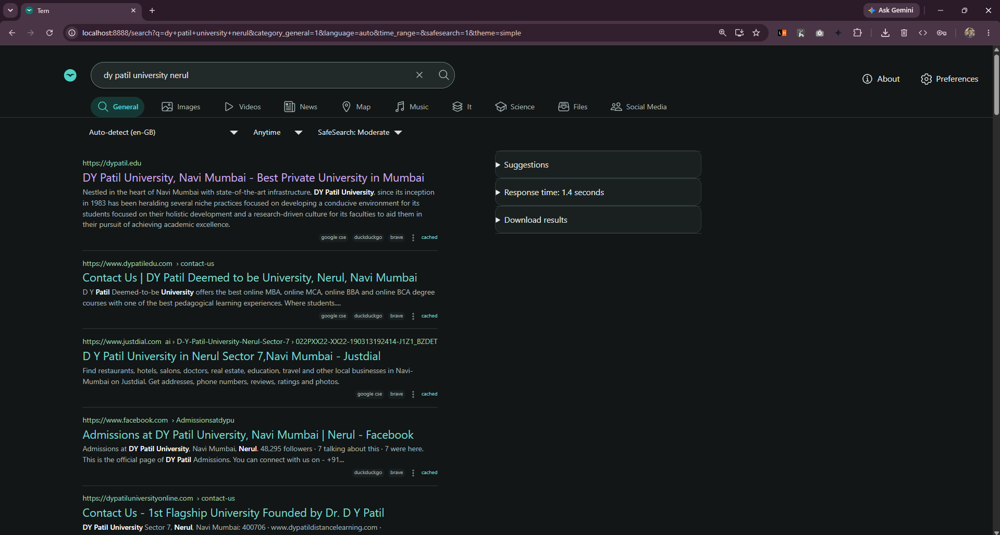
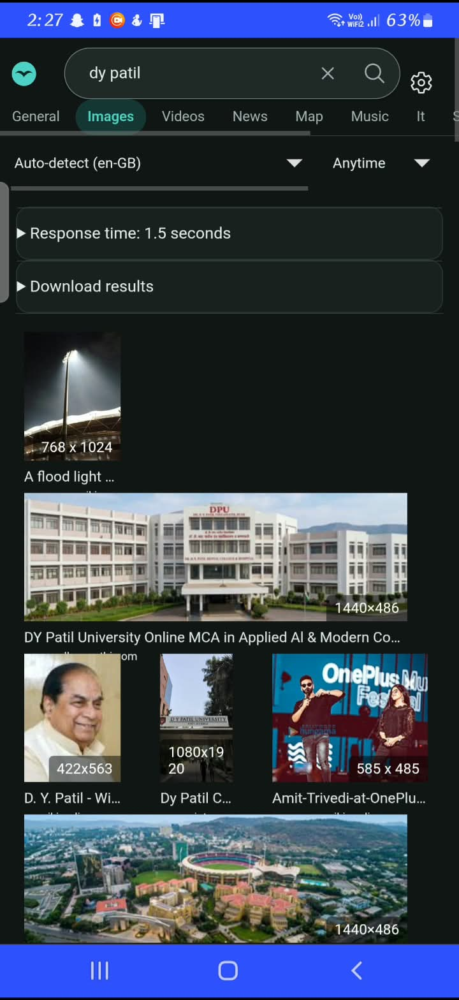
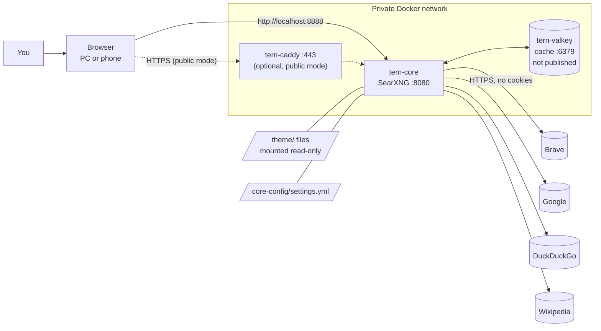

<div align="center">


# Tern

**A self-hosted private search engine built on SearXNG, Docker and Linux, with a custom, fast and accessible interface.**

Search the web through your own server. Results from many engines, no ads, no trackers, no profile.

[Features](#-features) · [How it differs](#-how-tern-is-different) · [Quick start](#-quick-start) · [Configuration](#%EF%B8%8F-configuration) · [Customise](#-customising-the-look) · [Structure](#-project-structure) · [Docs](#-documentation)

</div>

---

## 📖 Table of contents

- [About the project](#-about-the-project)
- [Screenshots](#-screenshots)
- [Features](#-features)
- [How Tern is different](#-how-tern-is-different)
- [Tech stack](#-tech-stack)
- [Architecture](#-architecture)
- [Requirements](#-requirements)
- [Quick start](#-quick-start)
- [Configuration](#%EF%B8%8F-configuration)
- [Using Tern](#-using-tern)
- [Use it on your other devices](#-use-it-on-your-other-devices)
- [Customising the look](#-customising-the-look)
- [Project structure](#-project-structure)
- [Everyday commands](#-everyday-commands)
- [Updating, backup and restore](#-updating-backup-and-restore)
- [Security and privacy](#-security-and-privacy)
- [Testing](#-testing)
- [Troubleshooting](#-troubleshooting)
- [Documentation](#-documentation)
- [Roadmap](#%EF%B8%8F-roadmap)
- [FAQ](#-faq)
- [License](#-license)
- [Acknowledgements](#-acknowledgements)
- [Author](#-author)

---

## 🧭 About the project

Every search on a mainstream engine becomes part of a profile used for advertising. Incognito mode doesn't stop that, and privacy-branded engines still require you to trust a company.

**Tern** is a private search engine you run yourself. When you search:

1. Your browser sends the query **only to your own server**.
2. The server (SearXNG) asks several search engines for you, **without your cookies or browser identity**.
3. It merges and ranks the answers, removes ads and tracking, and shows them in Tern's interface.

The engines see a request from your server. They don't see your browser, your accounts or your search history.

Tern is built on [SearXNG](https://github.com/searxng/searxng), an open-source metasearch engine. On top of it, the project adds a **custom design system and theme** inspired by the speed and simplicity of a modern browser's new-tab page, with its own name, logo and teal accent colour.

> **Honest limitation:** Tern gives you *privacy from profiling*, not *anonymity*. The engines still see your server's IP address and your search words. See [Security and privacy](#-security-and-privacy).

This started as a B.Tech CSBS academic project. The full report is in [`docs/07-report.md`](docs/07-report.md).

---

## 📸 Screenshots

> Add your own screenshots to `docs/screenshots/` and they'll appear here.

| Home (light) | Home (dark) |
|---|---|
|  |  |

| Results | Phone |
|---|---|
|  |  |

---

## ✨ Features

### Search
- 🔎 **Metasearch:** results from Brave, Google, DuckDuckGo, Wikipedia, Wikidata and 70+ other engines in one list
- 🗂️ **Categories:** General, Images, Videos, News, Map, Music, IT, Science, Files, Social Media
- 🛡️ **Safe search:** off, moderate (default) or strict
- ⌨️ **Autocomplete** suggestions while typing (can be switched off)
- 🌐 **Language and time filters** (any time, day, week, month, year)
- 📄 **Pagination**, plus a back button that works (GET requests)
- 🔌 **JSON, CSV and RSS output.** Use it as an API: `/search?q=linux&format=json`
- 📊 **Engine stats page** (`/stats`) with response times per engine
- ⚡ **Bang shortcuts** from SearXNG, e.g. `!wp tern` searches Wikipedia only

### Privacy
- 🚫 No ads, no tracking scripts, no analytics
- 🍪 No cookies sent to search engines
- 🖼️ **Image proxy:** thumbnails load through your server, so sites never see your IP
- 🔗 `no-referrer` policy, so websites you open can't see what you searched
- 🧱 **Zero third-party requests** from the interface: system fonts, inline SVG icons, letter avatars instead of remote favicons
- 🔐 Secret key kept only in `.env`, which Git never commits

### Interface (Tern theme)
- 🏠 **Minimal home page:** logo, one large pill-shaped search bar, and quick-link tiles you can edit in one file
- 🧩 **Category chips** under a compact header search bar that stays visible
- 📰 **One-column results** with a clear title / URL / snippet hierarchy and lots of whitespace
- 🌗 **Light, dark and black (OLED) modes** that follow your device automatically, with a manual switch in Preferences
- ⌨️ **Keyboard-first:** press `/` to jump to the search bar, visible focus rings, Enter to search, arrow keys for autocomplete
- 📱 **Fully responsive:** phone, tablet and desktop
- ♿ **Accessibility:** targets WCAG 2.2 AA, with every colour pair checked by a script; 44px touch targets; honours reduced motion
- 🎨 **Design tokens:** change the whole look by editing one CSS file
- 📲 **Installable:** Add to Home screen / Install app with Tern's own icon and name

### Deployment
- 🐳 **One command** to start: `docker compose up -d`
- 🔒 **Local-only by default** (listens on `127.0.0.1`)
- 🏡 Optional **home Wi-Fi**, **Tailscale** or **public HTTPS** (Caddy + Let's Encrypt) access
- 🔄 **Update checker** script that warns if SearXNG changed a template Tern overrides

---

## 🆚 How Tern is different

| | Google / Bing | Privacy-branded engines | Public SearXNG instance | **Tern** |
|---|---|---|---|---|
| Builds a profile of you | Yes | Claims not to | Depends on the operator | **No: no account, no cookies to engines** |
| Who could see your searches | The company | The company | A stranger running the server | **Only you (your server)** |
| Ads in results | Yes | Often | No | **No** |
| Results from multiple engines | No | Usually one partner index | Yes | **Yes** |
| Third-party scripts / fonts on the page | Yes | Varies | Varies | **None (verified in DevTools)** |
| Choose engines and safe-search policy | No | Limited | No (operator decides) | **Yes, full control** |
| Custom interface | No | No | No | **Yes: own design system and theme** |
| Cost | Free (you pay with data) | Free / paid | Free | **Free, open source** |
| Works offline from a company's servers | No | No | No | **Runs on your own PC** |

Compared with the original video tutorial this project started from, Tern also:
- uses the **current official** SearXNG Docker setup (the `searxng-docker` repository used in the video was **deprecated on 2026-03-28**)
- uses **Valkey** instead of Redis, and actually connects SearXNG to it (the official template leaves it unconnected)
- runs **local-only by default** instead of exposing a public server
- adds a **documented design system**, an accessible custom theme, helper scripts and a full test plan

---

## 🛠️ Tech stack

| Tool | Role | Licence |
|---|---|---|
| [SearXNG](https://github.com/searxng/searxng) | Metasearch engine (Python, Flask, Granian) | AGPL-3.0-or-later |
| [Docker](https://www.docker.com/) + Docker Compose | Containers and one-command deployment | Apache-2.0 (Engine); Docker Desktop free for personal/education |
| [Valkey](https://valkey.io/) | In-memory cache and bot-protection store (open-source Redis fork) | BSD-3-Clause |
| [Caddy](https://caddyserver.com/) *(optional)* | HTTPS reverse proxy with automatic Let's Encrypt certificates | Apache-2.0 |
| Ubuntu on WSL2 | Linux runtime for Docker on Windows | Various open-source |
| HTML, Jinja2, CSS custom properties | Theme templates and design tokens | n/a |
| JavaScript (vanilla, ~30 lines) | `/` keyboard shortcut | n/a |
| Python 3 + Pillow | Helper scripts: contrast checker, icon generator | PSF / HPND |
| Git, GitHub, VS Code | Version control, hosting, editing | Free |
| Mermaid | Diagrams in the docs | MIT |

---

## 🏗️ Architecture



**Security boundaries:** only port `8888` is published, and only on `127.0.0.1` by default. Valkey has no published port. Theme files are mounted read-only. The secret key lives only in `.env`.

More detail: [`docs/01-blueprint.md`](docs/01-blueprint.md).

---

## 📋 Requirements

| | Minimum | Recommended |
|---|---|---|
| OS | Windows 10 22H2 / 11 with WSL2, **or** Ubuntu 22.04+, **or** macOS | Windows 11 / Ubuntu 24.04 |
| CPU | 2 cores, virtualisation enabled in BIOS | 4+ cores |
| RAM | 4 GB | 8 GB+ |
| Disk | 5 GB free | 10 GB free |
| Software | Docker Desktop **or** Docker Engine with Compose v2, Git | + VS Code, Python 3 (for helper scripts) |
| Network | Internet access (outgoing HTTPS) | |

Everything is free. No paid cloud, domain, font or software is required.

---

## 🚀 Quick start

### 1. Get the code

```bash
git clone https://github.com/pradeep23234545/tern-search.git
cd tern-search
```

### 2. Create your `.env` and secret key

**Windows (PowerShell):**
```powershell
Copy-Item .env.example .env
powershell -ExecutionPolicy Bypass -File .\scripts\new-secret.ps1
```

**Ubuntu / WSL / macOS:**
```bash
cp .env.example .env
sh scripts/new-secret.sh
```

The script writes a random 64-character key into `.env` and never prints it.

### 3. Start it

```bash
docker compose up -d
```

### 4. Open it

Go to **http://localhost:8888** and search. Press `/` to jump to the search bar.

### 5. Check it's healthy

```bash
docker compose ps
```

Expected:
```
NAME          STATUS     PORTS
tern-core     Up …       127.0.0.1:8888->8080/tcp
tern-valkey   Up …       6379/tcp
```

> Two log lines saying `ahmia` / `torch: can't register engine` are normal. They're Tor-only engines that need a Tor proxy.

Step-by-step guide for beginners (installing WSL2, Docker and Git): [`docs/03-setup-guide.md`](docs/03-setup-guide.md).

---

## ⚙️ Configuration

### Environment variables (`.env`)

| Variable | Default | Meaning |
|---|---|---|
| `SEARXNG_SECRET` | *(generated)* | Signs cookies and tokens. **Keep it secret, never commit it** |
| `BIND_ADDRESS` | `127.0.0.1` | `127.0.0.1` = this PC only. `0.0.0.0` = also devices on your Wi-Fi |
| `HOST_PORT` | `8888` | Port on your computer |
| `SEARXNG_VERSION` | `latest` | Image tag. Pin one (e.g. `2026.11.2-cccbc9e15`) for repeatable installs |
| `SEARXNG_BASE_URL` | *(off)* | Public mode only: your public URL |
| `TERN_HOSTNAME` | *(off)* | Public mode only: domain for the HTTPS certificate |
| `TERN_ACME_EMAIL` | *(off)* | Public mode only: email for Let's Encrypt |
| `SEARXNG_LIMITER` | *(off)* | Public mode: turn on bot protection |

### Search settings (`core-config/settings.yml`)

| Setting | Current value | Change it to… |
|---|---|---|
| `general.instance_name` | `"Tern"` | Any name shown in the title and home page |
| `general.enable_metrics` | `true` | `false` hides `/stats` |
| `search.safe_search` | `1` | `0` off, `1` moderate, `2` strict |
| `search.autocomplete` | `"duckduckgo"` | `"brave"`, `"wikipedia"`, or `""` (off, most private) |
| `search.formats` | `html, json, csv, rss` | Remove `json` to disable the API |
| `server.image_proxy` | `true` | Keep `true` for privacy |
| `ui.theme_args.simple_style` | `auto` | `light`, `dark`, `black` |
| `engines` | examples | Add `- name: google` + `disabled: true` to turn an engine off |

Apply settings changes with:
```bash
docker compose restart core
```

Full reference: <https://docs.searxng.org/admin/settings/>

---

## 🔍 Using Tern

| Action | How |
|---|---|
| Search | Type and press **Enter**, or press `/` first from anywhere on the page |
| Change category | Click a chip: Images, Videos, News… |
| Filter by time / language / safe search | Drop-downs under the search bar |
| Change your own preferences | ⚙️ gear icon → Preferences → **Save** (stored in a cookie on your device only) |
| Search one engine | Bang syntax: `!wp`, `!gh`, `!yt` … (list in Preferences → Engines) |
| See engine health | Footer → **Engine stats** |
| Use the API | `http://localhost:8888/search?q=linux&format=json` |

**API example (PowerShell):**
```powershell
(Invoke-RestMethod "http://localhost:8888/search?q=linux&format=json").results |
  Select-Object -First 5 title, url
```

**API example (bash):**
```bash
curl -s "http://localhost:8888/search?q=linux&format=json" | python3 -m json.tool | head -40
```

### Make Tern your default search engine
- **Chrome / Edge:** Settings → Search engine → Manage search engines → *Site search* → **Add**
  - Name: `Tern` · Shortcut: `t` · URL: `http://localhost:8888/search?q=%s` → ⋮ → **Make default**
- **Firefox:** open Tern → right-click the address bar → **Add "Tern"** → Settings → Search → Default

---

## 📱 Use it on your other devices

| Option | Cost | Reach | Notes |
|---|---|---|---|
| **This PC only** (default) | Free | This computer | Safest |
| **Home Wi-Fi** | Free | Same Wi-Fi | Set `BIND_ADDRESS=0.0.0.0`, run `docker compose up -d`, open `http://<PC-IP>:8888` on the phone. Allow Docker on **Private** networks only |
| **Tailscale** ⭐ recommended | Free personal plan | Your devices, anywhere | Install on PC and phone, then `tailscale serve --bg 8888`. Private, encrypted, real HTTPS, no open ports |
| **Cloudflare Tunnel** | Free tier | Public | Needs a domain on Cloudflare; Cloudflare can see the traffic |
| **Free cloud VM + Caddy** | Free tier (e.g. Oracle Always Free) | Public, 24/7 | `docker compose --profile public up -d` with a domain; turn on the limiter |

Your PC has to be on for the first three options. Full instructions: [`docs/03-setup-guide.md`](docs/03-setup-guide.md#using-tern-on-your-other-devices).

---

## 🎨 Customising the look

Tern's look is controlled by **design tokens**: named CSS variables such as `--tern-color-accent`. Every component uses these names instead of raw colours, so changing one value restyles the whole interface.

### Change colours, fonts, spacing
1. Edit [`theme/static/tokens.css`](theme/static/tokens.css), e.g. `--tern-color-accent: #0f766e;`
2. Check accessibility still passes:
   ```bash
   python scripts/check-contrast.py
   ```
3. Apply and refresh:
   ```bash
   docker compose up -d --force-recreate core
   ```
   Then press **Ctrl + Shift + R** in the browser (SearXNG caches static files for up to 90 seconds).

### Change the quick-link tiles
Edit [`theme/templates/tern/quicklinks.html`](theme/templates/tern/quicklinks.html). One line per tile:
```jinja
("Wikipedia", "https://en.wikipedia.org/"),
```
Then recreate `core` as above.

### Change the logo
Edit `theme/templates/tern/mark.svg`, `theme/templates/searxng-wordmark.min.svg` and `theme/static/favicon.svg`, then regenerate the PNG app icons:
```bash
python -m pip install pillow
python scripts/make-icons.py
```

### How the theme plugs into SearXNG
- `theme/static/` is mounted read-only at `/usr/local/searxng/searx/static/themes/simple/tern/`
- Five templates (`base.html`, `index.html`, `page_with_header.html`, `manifest.json`, `searxng-wordmark.min.svg`) are mounted over SearXNG's `simple` theme. Every change in them is marked with a `TERN` comment
- `tern.css` first maps SearXNG's own `--color-*` variables to Tern tokens, then restyles components
- Original upstream copies are kept in `theme/upstream-snapshot/` for comparing after updates

The full rules are in the design system: [`design-system/skill.md`](design-system/skill.md).

---

## 📁 Project structure

```
tern-search/
├── README.md                      ← you are here
├── LICENSE                        MIT (with an AGPL exception for SearXNG-derived templates)
├── docker-compose.yml             Services: core (SearXNG), valkey (cache), caddy (optional HTTPS)
├── .env.example                   Template for .env (copy it; .env holds your secret)
├── .gitignore                     Keeps .env, logs and backups out of Git
│
├── core-config/
│   ├── settings.yml               SearXNG settings: name, safe search, autocomplete, engines, API
│   └── limiter.toml               Bot protection (used only in public mode)
│
├── caddy/
│   └── Caddyfile                  Optional HTTPS reverse proxy + security headers (CSP, HSTS…)
│
├── design-system/
│   └── skill.md                   Tern design system: tokens, components, accessibility, QA checklist
│
├── theme/
│   ├── static/                    → /static/themes/simple/tern/ inside the container
│   │   ├── tokens.css             ALL design tokens: edit this to restyle everything
│   │   ├── tern.css               Component styles (uses tokens only, no raw colours)
│   │   ├── tern.js                "/" keyboard shortcut (the only JavaScript Tern adds)
│   │   ├── favicon.svg            Browser tab icon
│   │   ├── icon-192.png           App icons (Add to Home screen / Install app)
│   │   ├── icon-512.png
│   │   └── apple-touch-icon.png
│   ├── templates/                 → mounted over SearXNG's "simple" theme templates
│   │   ├── base.html              Upstream copy + marked TERN changes (CSS, JS, icons, footer)
│   │   ├── index.html             Home page: logo, search bar, hint, quick links
│   │   ├── page_with_header.html  Header for Preferences, About and Stats
│   │   ├── manifest.json          Web app manifest (name, icons)
│   │   ├── searxng-wordmark.min.svg  Logo in the results header
│   │   └── tern/
│   │       ├── quicklinks.html    ← EDIT THIS to change the home-page tiles
│   │       └── mark.svg           Logo mark (uses colour tokens)
│   └── upstream-snapshot/         Original SearXNG files, for diffing after updates
│
├── scripts/
│   ├── new-secret.ps1 / .sh       Generate SEARXNG_SECRET into .env (never printed)
│   ├── check-upstream.ps1 / .sh   Warn if SearXNG changed a template Tern overrides
│   ├── check-contrast.py          Check WCAG contrast of every colour token pair
│   └── make-icons.py              Draw the PNG app icons from the logo shape
│
├── docs/
│   ├── 01-blueprint.md            Objectives, stack, architecture, roadmap
│   ├── 02-transcript-analysis.md  Video analysis and verification against current docs
│   ├── 03-setup-guide.md          Stage-by-stage setup (beginner-friendly)
│   ├── 04-security.md             Security and privacy explained
│   ├── 05-troubleshooting.md      Problem / cause / fix table
│   ├── 06-test-plan.md            Test cases (results filled in by the tester)
│   ├── 07-report.md               Academic project report
│   └── 08-enhancements.md         Optional future improvements
│
└── .vscode/
    └── extensions.json            Recommended free VS Code extensions
```

---

## 🧰 Everyday commands

| Task | Command |
|---|---|
| Start | `docker compose up -d` |
| Stop (keep containers) | `docker compose stop` |
| Start again | `docker compose start` |
| Remove containers (config and data kept) | `docker compose down` |
| Status | `docker compose ps` |
| Live logs | `docker compose logs -f core` |
| Apply `settings.yml` changes | `docker compose restart core` |
| Apply theme changes | `docker compose up -d --force-recreate core` |
| Check the cache | `docker exec tern-valkey valkey-cli ping` → `PONG` |
| Public HTTPS mode | `docker compose --profile public up -d` |

---

## 🔄 Updating, backup and restore

### Safe update
```bash
docker compose pull
```
```powershell
.\scripts\check-upstream.ps1      # Windows
```
```bash
sh scripts/check-upstream.sh      # Linux / WSL
```
```bash
docker compose up -d
```
If the checker prints **CHANGED** for a file, copy the new upstream version into `theme/templates/`, re-apply the lines marked `TERN`, and update `theme/upstream-snapshot/`. To roll back, set `SEARXNG_VERSION=<previous tag>` in `.env`.

### Backup
```powershell
New-Item -ItemType Directory -Force backups | Out-Null
tar -czf "backups/tern-$(Get-Date -Format yyyyMMdd).tar.gz" .env core-config theme caddy docker-compose.yml
```
The `backups/` folder is git-ignored because it contains your secret. Store copies somewhere private.

### Restore
Extract the archive into a new folder and run `docker compose up -d`.

---

## 🔐 Security and privacy

**What Tern protects:**
- Search engines don't get your cookies, browser fingerprint or account, so they can't link your searches into a profile
- No ads or trackers; images are proxied; websites you open don't get your query (`no-referrer`)
- The interface loads nothing from other domains, and the optional Caddy config adds a strict **Content-Security-Policy** so the browser blocks anything external

**What it doesn't protect:**
- Engines still see **your search words** and the **IP of the machine running Tern** (your home IP, if it runs at home)
- Autocomplete sends what you type to the provider (set `autocomplete: ""` to stop this)
- It is **not** a VPN, not Tor, and not anonymity

**Good practice:**
- Keep `BIND_ADDRESS=127.0.0.1` unless you need other devices; prefer Tailscale over opening ports
- Never commit `.env`. If the secret leaks, run the new-secret script again and recreate `core`
- Never publish the Valkey port
- In public mode: HTTPS only, `SEARXNG_LIMITER=true`, keep the OS and images updated

Full explanation: [`docs/04-security.md`](docs/04-security.md).

---

## ✅ Testing

- **Test plan:** [`docs/06-test-plan.md`](docs/06-test-plan.md) has functional, integration, deployment, security and UI/accessibility test cases (keyboard-only, focus, contrast, light/dark, responsive, reduced motion)
- **Contrast check:** `python scripts/check-contrast.py` checks 16 colour pairs in light and dark mode against WCAG 2.2 AA (all pass)
- **Privacy check:** DevTools → Network → reload. Every request should go to `localhost:8888`
- **Lighthouse:** DevTools → Lighthouse → Accessibility + Performance. Record your own scores in the test plan

---

## 🩺 Troubleshooting

| Problem | Fix |
|---|---|
| `docker version` has no "Server" section | Start Docker Desktop and wait for "Engine running" |
| `port is already allocated` | Change `HOST_PORT` in `.env` |
| Theme changes don't show | `docker compose up -d --force-recreate core`, then **Ctrl+Shift+R** |
| `duckduckgo (CAPTCHA)` | Normal now and then; other engines still answer |
| YAML error on start | Use 2 spaces, no tabs; test with `docker compose config` |
| Phone can't connect | Set `BIND_ADDRESS=0.0.0.0`, same Wi-Fi, allow Docker on Private networks |
| `.ps1 cannot be loaded` | Run with `powershell -ExecutionPolicy Bypass -File <script>` |

Full table: [`docs/05-troubleshooting.md`](docs/05-troubleshooting.md).

---

## 📚 Documentation

| Document | What's inside |
|---|---|
| [01 Blueprint](docs/01-blueprint.md) | Objectives, technology stack, architecture diagram, roadmap |
| [02 Transcript analysis](docs/02-transcript-analysis.md) | What the reference video shows, what's outdated, what was verified |
| [03 Setup guide](docs/03-setup-guide.md) | Stages 1–8: environment → deployment → theme → GitHub |
| [04 Security](docs/04-security.md) | How privacy works, limits, firewall, HTTPS, secrets |
| [05 Troubleshooting](docs/05-troubleshooting.md) | Problem / cause / safe fix |
| [06 Test plan](docs/06-test-plan.md) | Test cases with blank result columns |
| [07 Report](docs/07-report.md) | Academic report (exportable to PDF/Word) |
| [08 Enhancements](docs/08-enhancements.md) | Essential and optional next steps |
| [Design system](design-system/skill.md) | Tokens, components, accessibility rules, QA checklist |

---

## 🗺️ Roadmap

- [x] SearXNG + Valkey with Docker Compose
- [x] Local-only secure default
- [x] Tern design system and custom theme
- [x] Light / dark / black modes, keyboard shortcuts, responsive layout
- [x] JSON API, stats page, safe search
- [x] Update checker, contrast checker, icon generator
- [ ] Secure phone access with Tailscale
- [ ] Always-on free cloud deployment
- [ ] Edit quick links from the UI (stored on the device)
- [ ] Extra theme variants
- [ ] Optional Tor routing for engines

---

## ❓ FAQ

<details>
<summary><b>Is this completely anonymous?</b></summary>

No. It stops search companies from profiling *you* through your browser, but they still see the search words and your server's IP. For anonymity you would need Tor or a VPN on top.
</details>

<details>
<summary><b>Does it have its own index of the web?</b></summary>

No. Tern is a *metasearch* engine: it asks other engines and combines their results.
</details>

<details>
<summary><b>Why do I sometimes see "CAPTCHA" or "too many requests" for an engine?</b></summary>

Engines rate-limit IPs that send many automated requests. It's temporary, and the other engines keep working. You can disable an engine for a while in `settings.yml`.
</details>

<details>
<summary><b>Does it work when my PC is off?</b></summary>

Not if it runs on your PC. For 24/7 access, deploy it on a free cloud VM (see the setup guide).
</details>

<details>
<summary><b>Why port 8888 and not 8080?</b></summary>

8080 is often already used by other development tools. Change it with `HOST_PORT` in `.env`.
</details>

<details>
<summary><b>Will a SearXNG update break the theme?</b></summary>

Usually not, because Tern overrides only five files. Run `scripts/check-upstream` after `docker compose pull` and it tells you if any of them changed upstream.
</details>

---

## 📄 License

Tern's own code (theme CSS, scripts, configuration, docs) is released under the **MIT License**. See [`LICENSE`](LICENSE).

**Exception:** files in `theme/templates/` and `theme/upstream-snapshot/` are derived from SearXNG and remain under **AGPL-3.0-or-later**. SearXNG itself is AGPL-3.0-or-later: if you let other people use a modified instance, you must offer them its source code (Tern links to this repository from the footer via `settings.yml → brand`).

---

## 🙏 Acknowledgements

- [SearXNG](https://github.com/searxng/searxng) and its contributors, for the search engine this project is built on
- [Valkey](https://valkey.io/), [Caddy](https://caddyserver.com/) and [Docker](https://www.docker.com/)
- [NetworkChuck](https://youtu.be/ifT6npY39Dw), for the tutorial that inspired the project
- [W3C WCAG 2.2](https://www.w3.org/TR/WCAG22/), for the accessibility guidelines

---

## 👤 Author

**[Pradeep Dilip Yedage]**
B.Tech CSBS · [Ramrao Adik Institute Of Technology]

- GitHub: [@pradeep23234545](https://github.com/pradeep23234545)
- LinkedIn: [https://www.linkedin.com/in/pradeep-yedage-b474a0325/]

If this project helped you, consider giving it a ⭐ on GitHub.

<div align="center">

<sub>Built and verified on 2026-11-04 with <code>searxng/searxng:2026.11.2-cccbc9e15</code>, <code>valkey/valkey:9-alpine</code>, Docker 29.6.2 and Compose v5.3.1.</sub>

</div>
