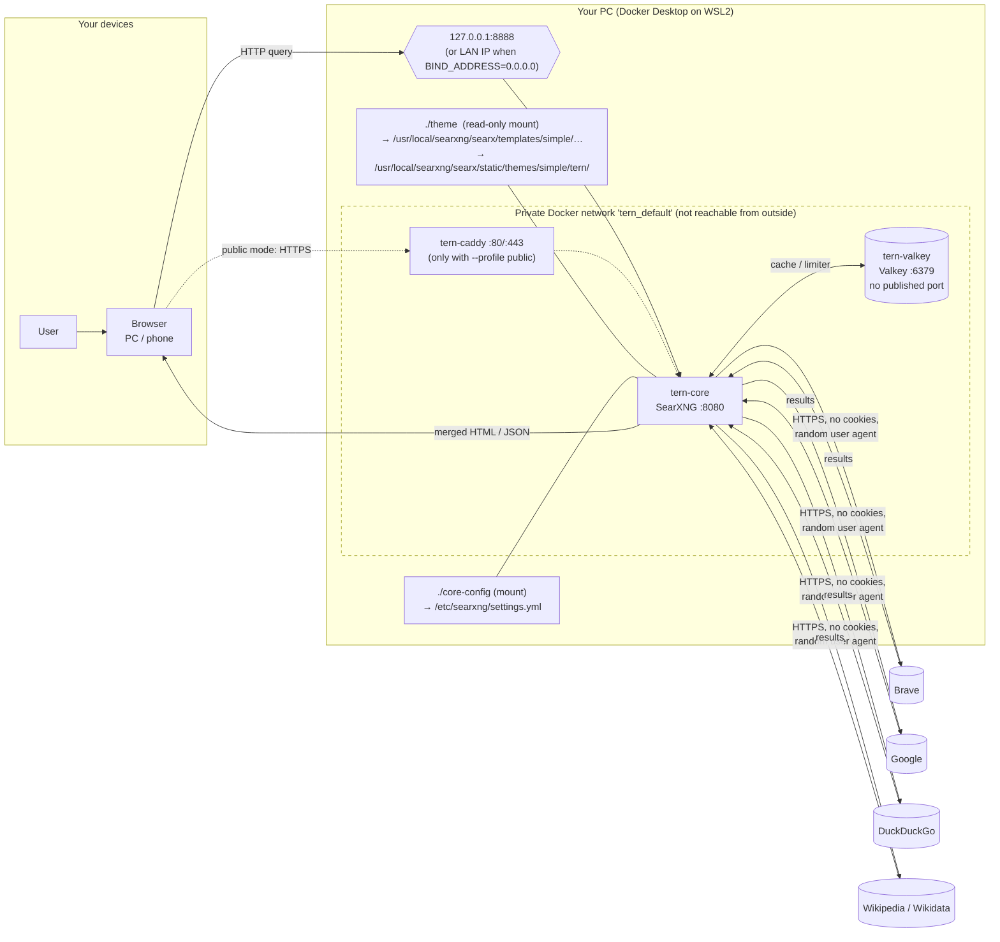

# 1. Project Blueprint

**Self-Hosted Private Search Engine Using SearXNG, Docker and Linux, with a custom browser-inspired interface ("Tern")**

## 1.1 Description and objectives

Tern is a private search engine you run yourself. When you search, your own server asks many search engines (Brave, Google, DuckDuckGo, Wikipedia and others) on your behalf, merges the answers, strips trackers and ads, and shows them in a clean interface. The search companies see your server, not your browser, cookies or history.

| # | Objective | Delivered by |
|---|---|---|
| O1 | Web search UI reachable from a browser | SearXNG `core` container on `http://localhost:8888` |
| O2 | Results from multiple engines in one list | SearXNG metasearch (70+ engines) |
| O3 | Reduced tracking: no cookies to engines, no ads, no profiling | SearXNG design + image proxy + `no-referrer` |
| O4 | Admin control over engines, safe search, autocomplete | `core-config/settings.yml` |
| O5 | Per-user preferences (theme, language, engines) | SearXNG Preferences page (stored in the user's own cookie) |
| O6 | One-command deployment | Docker Compose |
| O7 | Local-first, optional free public access | `127.0.0.1` binding by default; LAN, Tailscale, Cloudflare Tunnel or Caddy as options |
| O8 | Custom, fast, accessible UI | Tern design system + theme overrides |

## 1.2 Technology stack (in plain words)

| Part | What it is | Why we need it | How it talks to the others |
|---|---|---|---|
| **SearXNG** | Open-source metasearch engine (Python, AGPL-3.0) | The search engine itself | Receives your query over HTTP on port 8080 inside Docker, calls external engines over HTTPS, returns a web page or JSON |
| **Docker** | Runs programs in *containers*: sealed boxes that carry everything the program needs | Same setup on any PC, no Python installs, easy updates | Starts the containers and the private network between them |
| **Docker Compose** | A YAML file that describes several containers together | One command (`docker compose up -d`) starts everything | Reads `docker-compose.yml` and `.env` |
| **Ubuntu / WSL2** | Linux. WSL2 runs a real Linux kernel inside Windows | Docker containers are Linux programs | Docker Desktop uses WSL2 under the hood on Windows |
| **Valkey** | Small in-memory database (open-source fork of Redis) | Cache and bot-protection counters for SearXNG | SearXNG connects to `valkey://valkey:6379` on the private Docker network only |
| **Caddy** (optional) | Web server / *reverse proxy* that gets free HTTPS certificates automatically | Only needed for a public server with a domain | Receives internet traffic on 443, forwards it to `core:8080` |
| Nginx (alternative) | Popular reverse proxy | Same job as Caddy, but certificates need extra setup (certbot) | Same position as Caddy |
| **Git + GitHub** | Version control + free online hosting of your repository | History of every change, backup, sharing for your viva | You commit files locally, push to GitHub |
| **VS Code** | Free code editor | Edit YAML, CSS, templates; preview Markdown and Mermaid | Opens the project folder |
| **Tern design system + theme** | `design-system/skill.md` (rules) + `theme/` (CSS, templates) | Own look: Chrome-like simplicity, own brand, WCAG 2.2 AA | Theme files are *mounted* (shared read-only) into the SearXNG container |
| DNS (public only) | Maps a name like `search.example.org` to an IP address | Needed for HTTPS certificates | A record → server IP |

**Words used above.** *Container*: a running, isolated copy of a program. *Image*: the read-only template a container is created from (like an installer). *Volume*: a storage folder Docker keeps between restarts. *Reverse proxy*: a front door server that forwards visitors to the real app. *YAML*: a text format where indentation (spaces) shows structure.

## 1.3 Requirements (all free)

| | Minimum | Recommended | Measured on this PC |
|---|---|---|---|
| OS | Windows 10 22H2 / 11 with WSL2, or Ubuntu 22.04+ | Windows 11 or Ubuntu 24.04 | Windows 11 Home, WSL2 |
| CPU | 2 cores, virtualisation enabled in BIOS | 4 cores | 16 threads |
| RAM | 4 GB (Docker Desktop itself uses ~2 GB) | 8 GB+ | 16 GB |
| Disk | 5 GB free | 10 GB free | 173 GB free |
| Software | Docker Desktop (free for personal/education) or Docker Engine, Git, VS Code | + Python 3 (only for helper scripts) | Docker 29.6.2, Compose v5.3.1, Git 2.55, Python 3.14 |
| Network | Internet access for outgoing HTTPS | | |

## 1.4 Architecture



**Security boundaries:** (1) only port 8888 is published, and by default only on `127.0.0.1`; (2) Valkey has no published port; (3) theme and templates are mounted read-only; (4) the secret key lives only in `.env`, which Git ignores.

## 1.5 Repository structure

```
searxng-private-search/
├── README.md                     Quick start and daily use
├── docker-compose.yml            The three services (core, valkey, optional caddy) + theme mounts
├── .env.example                  Template for .env (copy it; .env holds your secret, never committed)
├── .gitignore                    Keeps .env, logs, backups out of Git
├── core-config/
│   ├── settings.yml              SearXNG settings (name, safe search, autocomplete, engines, API)
│   └── limiter.toml              Bot protection (used only when public)
├── caddy/
│   └── Caddyfile                 Optional HTTPS reverse proxy + security headers (CSP)
├── design-system/
│   └── skill.md                  Tern design system (tokens, components, a11y, QA)
├── theme/
│   ├── static/                   → mounted at /static/themes/simple/tern/
│   │   ├── tokens.css            ALL design tokens (edit this to restyle everything)
│   │   ├── tern.css              Component styles (uses tokens only)
│   │   ├── tern.js               "/" keyboard shortcut (only JavaScript we add)
│   │   ├── favicon.svg, icon-192.png, icon-512.png, apple-touch-icon.png
│   ├── templates/                → mounted over SearXNG's simple theme templates
│   │   ├── base.html             Upstream copy + 4 marked TERN changes (CSS/JS/icons/footer)
│   │   ├── index.html            Home page: logo, search bar, quick links
│   │   ├── page_with_header.html Preferences/About/Stats header
│   │   ├── manifest.json         "Install app" / Add to Home screen data
│   │   ├── searxng-wordmark.min.svg  Logo in the results header
│   │   └── tern/
│   │       ├── quicklinks.html   EDIT THIS to change the quick-link tiles
│   │       └── mark.svg          Logo mark (uses colour tokens)
│   └── upstream-snapshot/        Original upstream files, for diffing after updates
├── scripts/
│   ├── new-secret.ps1 / .sh      Generate SEARXNG_SECRET into .env (never printed)
│   ├── check-upstream.ps1 / .sh  Detect upstream template changes after an update
│   ├── check-contrast.py         Verify WCAG contrast of every token pair
│   └── make-icons.py             Re-draw PNG app icons from the logo geometry
└── docs/
    ├── 01-blueprint.md           (this file)
    ├── 02-transcript-analysis.md Video analysis + verification against current docs
    ├── 03-setup-guide.md         Stage-by-stage commands (Stages 1–8)
    ├── 04-security.md            Security and privacy
    ├── 05-troubleshooting.md     Problem / cause / fix
    ├── 06-test-plan.md           Test cases (your results left blank)
    ├── 07-report.md              Academic report
    └── 08-enhancements.md        Optional extras
```

## 1.6 Roadmap

| Stage | Content | Time | Difficulty | Likely problems |
|---|---|---|---|---|
| 1 Environment | WSL2, Docker, Git, VS Code, GitHub | 1–2 h (0 h here: already installed) | Easy–Medium | BIOS virtualisation off, WSL update needed |
| 2 Project setup | Folder, Git init, `.gitignore` | 15 min | Easy | Wrong folder, line endings |
| 3 Configuration | `.env`, secret, `settings.yml` | 30 min | Easy | YAML indentation |
| 4 Deployment | `docker compose up -d`, logs | 15 min | Easy | Port in use (8080 was taken here → 8888) |
| 5 Testing | Searches, engines, preferences, stats | 30 min | Easy | Engine CAPTCHAs |
| 6 Functional customisation | Name, engines, autocomplete, safe search, JSON API | 30 min | Easy | Forgetting to restart |
| 7 UI theme | Tokens, templates, DevTools, Lighthouse | 2–4 h | Medium | Browser cache, upstream CSS specificity |
| 8 Maintenance & GitHub | Update, backup, restore, push | 30 min | Easy | Accidentally committing `.env` |
