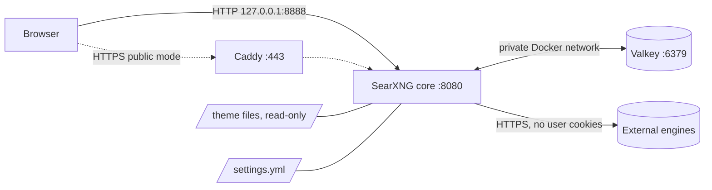
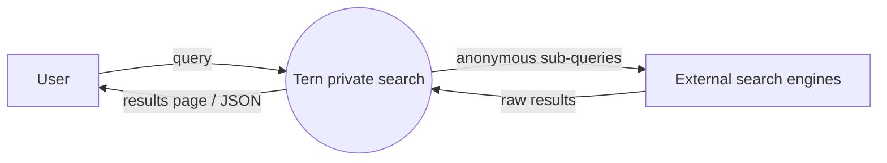
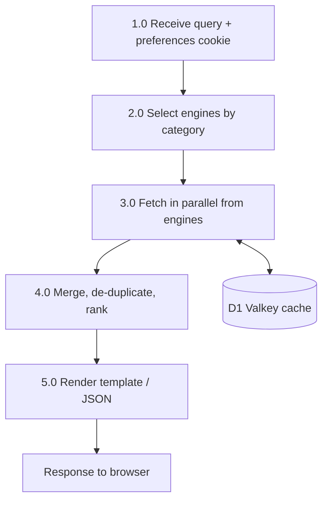
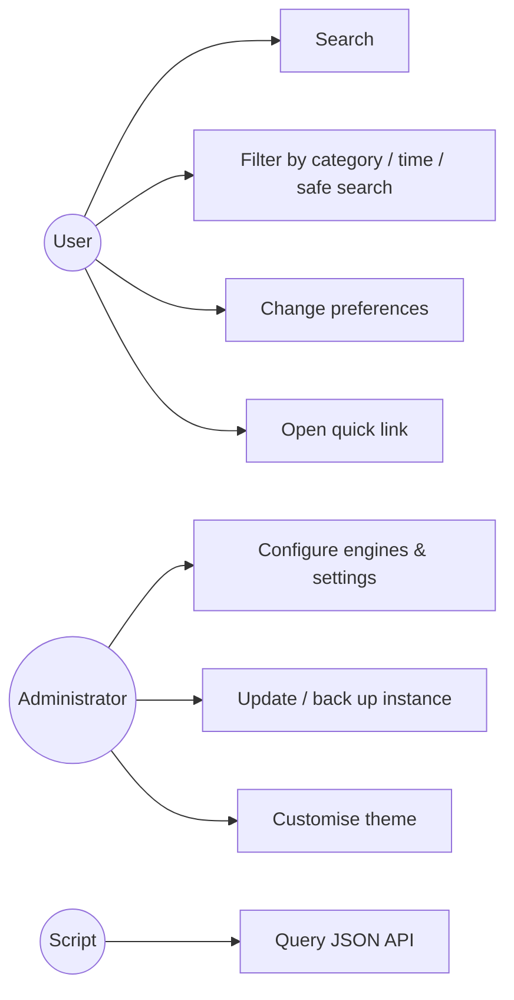
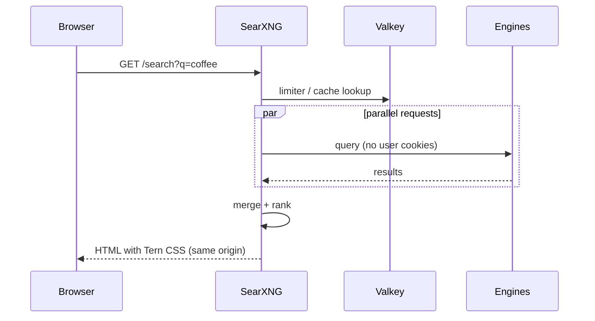

# Abstract
Mainstream search engines link every query to a persistent user profile used for advertising. This project builds a self-hosted private metasearch engine on SearXNG, deployed with Docker Compose on Windows (WSL2) and Linux, with a Valkey cache and an optional Caddy HTTPS proxy. The server sends queries to several engines without user cookies, merges the results and returns them without ads or trackers. A custom interface, Tern, was designed through a token-based design system targeting WCAG 2.2 AA. It provides a minimal home page, category chips, a one-column result layout, light/dark themes and keyboard shortcuts, and makes zero third-party network requests. The report covers the architecture, implementation, security analysis and a test plan.

# 1. Introduction
A search query reveals intent, health, location and beliefs. Metasearch engines forward queries to other engines and aggregate the answers. Running one yourself removes the middle party's data collection and gives the owner full control over engines, filtering and presentation.

# 2. Problem Statement
Users have no practical way to search the web without being profiled by the search provider, and existing privacy front-ends are run by third parties the user must trust. The goal is a private search service that a student can deploy, understand, customise and maintain with free tools only.

# 3. Existing System
Commercial engines (Google, Bing) with account-linked history; privacy-branded engines that depend on another provider's index; public SearXNG instances run by volunteers.

# 4. Limitations of Existing System
| Limitation | Effect |
|---|---|
| Persistent profiling, cookies, fingerprinting | Behavioural advertising, data-broker exposure |
| Third-party scripts, fonts and pixels on result pages | Additional trackers beyond the search provider |
| Public instances | Operator can log queries; instances are rate-limited or unavailable |
| No owner control | Cannot choose engines, safe-search policy or interface |

# 5. Proposed System
A self-hosted SearXNG instance in Docker Compose (`core` + `valkey`, optional `caddy`), configured through `settings.yml` and `.env`, with the Tern theme mounted read-only over SearXNG's `simple` theme. It is bound to `127.0.0.1` by default, with documented LAN, Tailscale and public HTTPS options.

# 6. Objectives
1. Deploy a working metasearch engine reachable from a browser.
2. Aggregate results from multiple engines.
3. Minimise tracking: no cookies upstream, image proxy, no referrer, no external assets.
4. Provide admin control (engines, safe search, autocomplete, API) and user preferences.
5. Design and implement an accessible, responsive, browser-inspired UI from a design system.
6. Document security, testing and maintenance.

# 7. Scope
**In scope:** local deployment on Windows/WSL2 and Ubuntu; LAN/Tailscale access; optional public HTTPS; UI theme; JSON API. **Out of scope:** own web crawler/index, user accounts, anonymity guarantees (Tor/VPN), mobile native apps.

# 8. Literature and Technology Review
| Technology | Role | Licence |
|---|---|---|
| SearXNG | Metasearch engine (Python/Flask, Granian server) | AGPL-3.0-or-later |
| Docker / Docker Compose | Containerisation and orchestration | Apache-2.0 (Engine); Docker Desktop free for personal/education |
| Valkey | In-memory key-value cache (Redis fork) | BSD-3-Clause |
| Caddy | Reverse proxy with automatic HTTPS (ACME / Let's Encrypt) | Apache-2.0 |
| WSL2 / Ubuntu | Linux runtime on Windows | Microsoft / GPL components |
| WCAG 2.2 | Accessibility standard (W3C) | W3C |
| Design tokens | Named design decisions as variables (W3C Design Tokens Community Group concept) | n/a |

The deprecated `searxng-docker` repository (used in the reference tutorial) was superseded in March 2026 by the official compose template in the SearXNG repository. This project follows the current template; see `docs/02-transcript-analysis.md`.

# 9. Hardware Requirements
| | Minimum | Used for development |
|---|---|---|
| CPU | 2 cores with virtualisation | [FILL IN e.g. 16 logical processors] |
| RAM | 4 GB | [FILL IN e.g. 16 GB] |
| Storage | 5 GB free | [FILL IN] |
| Network | Broadband internet | [FILL IN] |

# 10. Software Requirements
Windows 10/11 with WSL2 or Ubuntu 22.04+; Docker Desktop or Docker Engine with Compose v2+; Git; VS Code; a modern browser; Python 3 (helper scripts only). Images: `searxng/searxng` ([FILL IN tag]), `valkey/valkey:9-alpine`, `caddy:2-alpine` (optional).

# 11. System Architecture

Only the SearXNG port is published (to localhost by default). Valkey is reachable solely inside the Docker network.

# 12. Data Flow Diagram
**Level 0 (context):**

**Level 1:**

# 13. UML Diagrams
**Use case**

**Sequence: one search**

# 14. UI/UX Design Approach
The interface follows `design-system/skill.md`, which is written to the provided DESIGN.md blueprint.
- **Tokens:** typography (12–44px scale, system fonts), semantic colours for light and dark (e.g. `--tern-color-accent`), 4px spacing scale, radius (6/12/16/pill), two shadows, motion (120/180ms, zero under reduced-motion). All values live in `theme/static/tokens.css`.
- **Bridge layer:** SearXNG's own `--color-*` variables are mapped to Tern tokens, so upstream components follow the theme without being rewritten.
- **Components:** search bar, buttons, category chips, result item, quick-link tile, pagination, preferences controls, empty / no-results / error states, each with default, hover, focus-visible, active, disabled, loading and error rules.
- **Accessibility:** WCAG 2.2 AA; every token pair verified by `scripts/check-contrast.py` (text ≥4.5:1, UI ≥3:1); 3px focus ring; `/` shortcut; 44px touch targets; reflow at 320px.
- **Privacy by design:** no web fonts, no CDN, letter avatars instead of remote favicons, strict CSP in the public configuration.

# 15. Module Description
| Module | Files | Responsibility |
|---|---|---|
| Search core | `searxng/searxng` image, `core-config/settings.yml` | Query engines, merge results, preferences, API |
| Cache | `valkey` service | Caching and limiter state |
| Reverse proxy (optional) | `caddy/Caddyfile` | HTTPS, security headers |
| Configuration | `.env`, `scripts/new-secret.*` | Secrets, ports, versions |
| Theme | `theme/static/*`, `theme/templates/*` | Tern look, home page, quick links, icons |
| Design system | `design-system/skill.md` | Rules, tokens, QA |
| Maintenance | `scripts/check-upstream.*`, `check-contrast.py`, `make-icons.py` | Update safety, accessibility checks, assets |

# 16. Implementation
1. Verified the current official deployment method and found that `searxng-docker` was deprecated.
2. Pulled the images and inspected the real template and static layout inside the container.
3. Wrote the compose file from the official template, adding a localhost binding, the Valkey URL, read-only theme mounts and an optional Caddy profile.
4. Generated the secret with a cryptographic RNG script.
5. Built the design system, tokens and component CSS; overrode five templates with marked changes and kept upstream snapshots for diffing.
6. Tested in the browser at desktop and phone widths, in light and dark.

[INSERT SCREENSHOT: VS Code with project tree]
[INSERT SCREENSHOT: `docker compose ps` output]

# 17. Testing
The test plan in `docs/06-test-plan.md` covers functional, integration, deployment, security and UI/accessibility tests. [INSERT completed test table or summary: number of tests run / passed]

# 18. Results and Screenshots
[INSERT SCREENSHOT: home page, light mode, desktop]
[INSERT SCREENSHOT: home page, dark mode, phone]
[INSERT SCREENSHOT: results page, light mode]
[INSERT SCREENSHOT: results page, dark mode]
[INSERT SCREENSHOT: preferences page]
[INSERT SCREENSHOT: /stats page]
[INSERT SCREENSHOT: DevTools Network tab showing only localhost requests]
[INSERT SCREENSHOT: Lighthouse report, with your measured scores]
[INSERT: JSON API output sample]

# 19. Advantages
No profiling or ads; results from many engines; owner control; free and open source; reproducible with one command; accessible, fast interface with zero external requests; easy theming via tokens.

# 20. Limitations
Not anonymous (the engines see the server's IP and the query); depends on upstream engines that may rate-limit or CAPTCHA; a home instance is available only while the PC is on; the theme overrides are not an officially supported SearXNG mechanism, so templates need checking after updates; a single-user instance offers no crowd anonymity.

# 21. Future Enhancements
See `docs/08-enhancements.md`: reverse-proxy authentication, Tor/proxy routing for engines, theme variants, always-on free VM, editable quick links UI, personal engine profiles.

# 22. Conclusion
The project delivers a working private search engine that a beginner can deploy in minutes and maintain with free tools. It updates the reference tutorial to 2026 practice (official compose template, Valkey, Compose v2) and adds a documented design system and accessible custom interface, while stating its privacy limits honestly.

# 23. References
*(Verify each link before submission.)*
1. SearXNG documentation. https://docs.searxng.org/
2. SearXNG Docker installation. https://docs.searxng.org/admin/installation-docker.html
3. SearXNG source repository. https://github.com/searxng/searxng
4. searxng-docker (deprecated). https://github.com/searxng/searxng-docker
5. Docker documentation. https://docs.docker.com/
6. Valkey project. https://valkey.io/
7. Caddy documentation. https://caddyserver.com/docs/
8. W3C, Web Content Accessibility Guidelines (WCAG) 2.2. https://www.w3.org/TR/WCAG22/
9. Microsoft, Install WSL. https://learn.microsoft.com/windows/wsl/install
10. NetworkChuck, YouTube tutorial (reference video). https://youtu.be/ifT6npY39Dw

---
**Export to PDF/Word (free):** VS Code extension *Markdown PDF* → right-click → *Markdown PDF: Export (pdf)*; or Pandoc: `pandoc docs/07-report.md -o report.docx` (Mermaid diagrams: export them as PNG from https://mermaid.live first, or use the *Markdown Preview Mermaid Support* extension and print to PDF).
